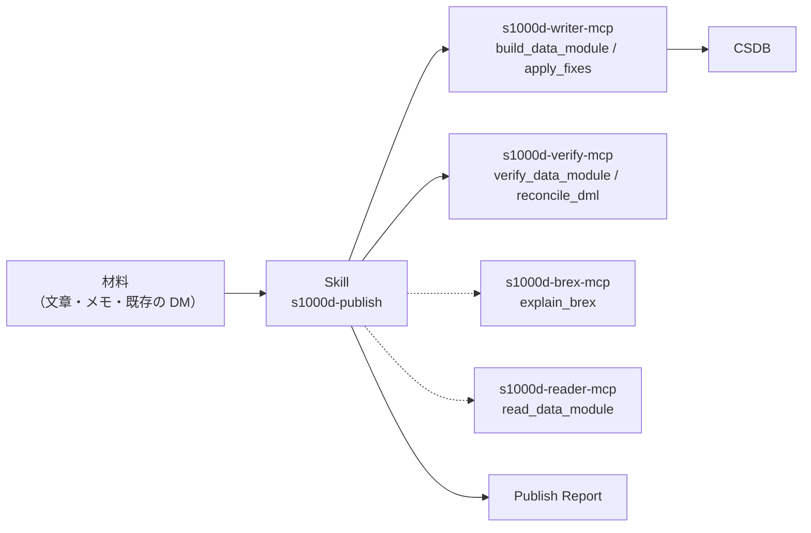

# s1000d-publish-skill

[English](./README.md) | **日本語**

[](./LICENSE)

構造化した下書きから S1000D® のデータモジュールを 1 件ずつ作り、検証を通して CSDB に入れる Claude Skill です。体験型マニュアルを経由しない、技術文書の書き手向けです。どのツールをどの順番で呼ぶか、各段階で利用者に何を聞くかを、Claude に伝えます。

> [!IMPORTANT]
> このプロジェクトは ASD（Aerospace, Security and Defence Industries Association of Europe）とは無関係の個人プロジェクトです。S1000D® は ASD の登録商標です。
> S1000D の仕様書・XML スキーマ・既定 BREX・公式サンプルは、利用条件により再配布できないため、どのパッケージにもリポジトリにも含まれていません。s1000d.org から入手し、展開したフォルダーを環境変数 `S1000D_SPEC_DIR` で指定してください。

## 提供するもの

このリポジトリは MCP サーバーではなく Skill です。Markdown の手順書で、組み立てや検証の処理は持ちません。判定はすべて S1000D の MCP サーバーの応答を根拠にします。



### 原則

1. Skill は XML を書きません。書くのは下書きの木（題名・段落・手順・警告・表・参照）で、XML は writer サーバーが組み立てます。
2. 判定はサーバーが下し、Skill は説明します。XSD・BREX・参照・DML の結果と修正の候補はサーバーの応答を根拠にし、上書きしません。
3. 候補の外の値を使いません。修正は `fixes[]` の候補から選びます。`confidence: none` のときと `range` / `pattern` の候補のときは、利用者に聞きます。
4. 利用者が確認する前に書き込みません（`write: true`）。
5. 検証状態を必ず報告します。`schema-not-found` と `not-run` を合格とは書かず、S1000D への準拠は判定しません。
6. 必須の MCP サーバーが接続されていなければ、Skill は止まり、接続の方法を伝えます。

## 作業の流れ

1. 材料、新規か書き直しか、CSDB のフォルダー、機密区分を確かめます。
2. 種類（説明・手順・プロセス・故障探求）を利用者と決めます。
3. brex サーバーが接続されていれば、プロジェクトの BREX の決まりを書き手向けに要約します。
4. 採番の規則を聞きます。種類ごとの情報コードも含みます。情報コードの既定はありません。
5. 下書きを作って利用者に見せ、`build_data_module` を `write: false` で実行します。
6. 残った修正を片付け、利用者の確認の後に `write: true` で書き込み、書いたデータモジュールを検証します。
7. DML との照合（`reconcile_dml`）を行い、新しいデータモジュールが DML に載っているかを報告します。DML の作成・更新は writer にまだありません。
8. Publish Report を返します。

判断の基準は `references/` にあります。[kinds.md](skills/s1000d-publish/references/kinds.md)（種類の使い分けと、種類ごとに置ける節点）、[draft.md](skills/s1000d-publish/references/draft.md)（下書きの書き方と、JSON の最小の例 2 つ）、[report.md](skills/s1000d-publish/references/report.md)（報告の雛形）です。

## 前提の MCP サーバー

| MCP サーバー | 必須 | 最低版 | 役割 |
|---|---|---|---|
| [s1000d-writer-mcp](https://www.npmjs.com/package/@shuji-bonji/s1000d-writer-mcp) | 必須 | 0.1.1 | `build_data_module`、`apply_fixes` |
| [s1000d-verify-mcp](https://www.npmjs.com/package/@shuji-bonji/s1000d-verify-mcp) | 必須 | 0.6.1 | `verify_data_module`、`reconcile_dml` |
| [s1000d-brex-mcp](https://www.npmjs.com/package/@shuji-bonji/s1000d-brex-mcp) | 任意 | 0.4.0 | `explain_brex` |
| [s1000d-reader-mcp](https://www.npmjs.com/package/@shuji-bonji/s1000d-reader-mcp) | 任意 | 0.7.1 | `read_data_module` |

`s1000d-writer-mcp` と `s1000d-verify-mcp` は `plugin.json` の `dependencies` に宣言してあります。任意のサーバーが無いときは、報告の該当項目に「未実施（ツール未接続）」と書きます。

## インストール

```bash
/plugin marketplace add shuji-bonji/claude-plugins
/plugin install s1000d-writer-mcp@shuji-bonji   # 必須
/plugin install s1000d-verify-mcp@shuji-bonji   # 必須
/plugin install s1000d-publish@shuji-bonji
```

Releases の `.plugin` ファイルを Cowork に追加するか、`skills/s1000d-publish/` を `~/.claude/skills/` にコピーしても使えます。

## ディレクトリ構成

```text
s1000d-publish-skill/
├── .claude-plugin/plugin.json
├── skills/s1000d-publish/
│   ├── SKILL.md
│   └── references/ (kinds.md, draft.md, report.md)
├── evals/trigger-eval.json
├── .github/workflows/release.yml
├── README.md / README.ja.md
├── CHANGELOG.md
└── LICENSE
```

> [!NOTE]
> `SKILL.md` と `references/` は日本語で書いています。Claude は会話の言語にかかわらず従います。

## ライセンス

MIT。この Skill が出すのはデータモジュールと検証状態で、S1000D への準拠の判定ではありません。
