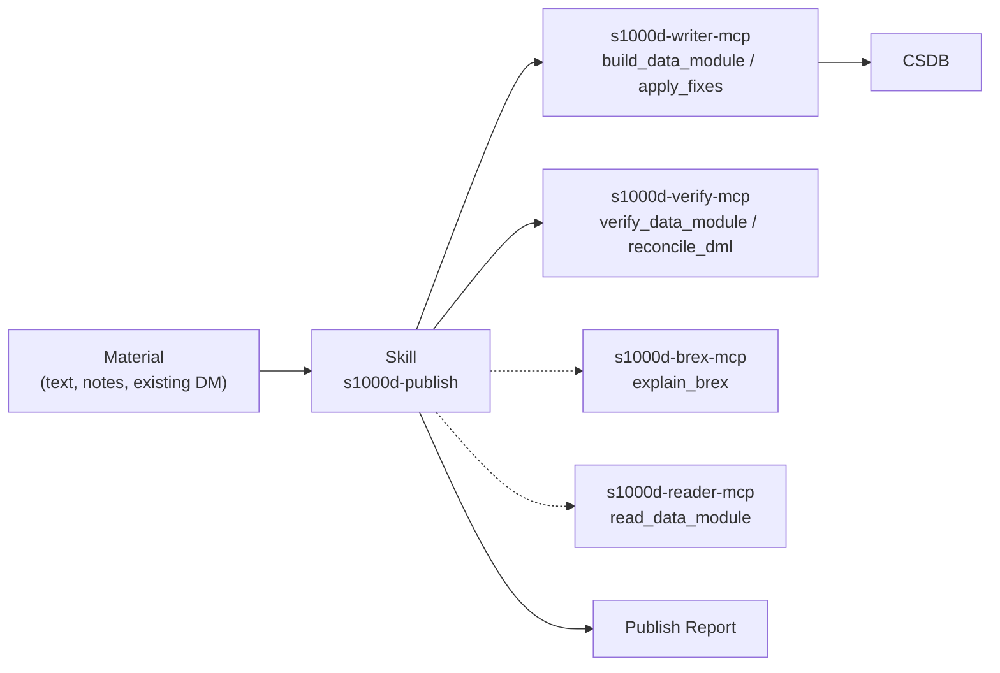

# s1000d-publish-skill

**English** | [日本語](./README.ja.md)

[](./LICENSE)

A Claude Skill that builds S1000D® data modules one at a time from a structured draft, verifies them and puts them into a CSDB. It is meant for technical writers who do not start from an experiential manual. It tells Claude which tool to call, in which order, and what to ask you at each step.

> [!IMPORTANT]
> This is a personal project and is not affiliated with ASD (Aerospace, Security and Defence Industries Association of Europe). S1000D® is a registered trademark of ASD.
> The S1000D specification, XML schemas, default BREX and official samples are not included in any package or repository, because their terms of use do not grant redistribution. Obtain them from s1000d.org and point the `S1000D_SPEC_DIR` environment variable at the extracted folder.

## What it provides

This repository is a Skill, not an MCP server. It is a Markdown playbook. It holds no building or validation code; every judgment comes from the responses of the S1000D MCP servers.



### Principles

1. The Skill never writes XML. It writes a draft tree (titles, paragraphs, steps, warnings, tables, references), and the writer server builds the XML.
2. The servers decide; the Skill explains. XSD, BREX, reference and DML results, and fix candidates, come from server responses and are never overridden.
3. No value outside the candidates. A fix is chosen from `fixes[]`. For `confidence: none`, or a `range` / `pattern` candidate, the Skill asks you.
4. Nothing is written before you confirm (`write: true`).
5. The verification status is always reported. `schema-not-found` and `not-run` are never reported as a pass, and S1000D conformance is not decided.
6. If a required MCP server is not connected, the Skill stops and tells you how to connect it.

## What publishing looks like

1. Confirm the material, whether it is new or a rewrite, the CSDB folder and the security classification.
2. Decide the kind with you: description, procedure, process or fault isolation.
3. If the BREX server is connected, summarize the project's BREX rules for the writer.
4. Ask for the numbering rules, including the information code for the kind. There is no default for information codes.
5. Build the draft, show it to you, and run `build_data_module` with `write: false`.
6. Resolve the remaining fixes, then write with `write: true` after your confirmation and verify the written data module.
7. Reconcile with the DML (`reconcile_dml`) and report whether the new data module is listed. Creating or updating a DML is not available in the writer yet.
8. Return a Publish Report.

The references hold the criteria: [kinds.md](skills/s1000d-publish/references/kinds.md) (which kind to use, and which nodes each kind accepts), [draft.md](skills/s1000d-publish/references/draft.md) (how to write a draft, with two minimal JSON examples) and [report.md](skills/s1000d-publish/references/report.md) (the report template).

## Prerequisite MCP servers

| MCP server | Required | Minimum version | Role |
|---|---|---|---|
| [s1000d-writer-mcp](https://www.npmjs.com/package/@shuji-bonji/s1000d-writer-mcp) | Yes | 0.1.1 | `build_data_module`, `apply_fixes` |
| [s1000d-verify-mcp](https://www.npmjs.com/package/@shuji-bonji/s1000d-verify-mcp) | Yes | 0.6.1 | `verify_data_module`, `reconcile_dml` |
| [s1000d-brex-mcp](https://www.npmjs.com/package/@shuji-bonji/s1000d-brex-mcp) | No | 0.4.0 | `explain_brex` |
| [s1000d-reader-mcp](https://www.npmjs.com/package/@shuji-bonji/s1000d-reader-mcp) | No | 0.7.1 | `read_data_module` |

`s1000d-writer-mcp` and `s1000d-verify-mcp` are declared in `dependencies` of `plugin.json`. Without the optional servers, the corresponding items in the report say "not performed (tool not connected)".

## Installation

```bash
/plugin marketplace add shuji-bonji/claude-plugins
/plugin install s1000d-writer-mcp@shuji-bonji   # required
/plugin install s1000d-verify-mcp@shuji-bonji   # required
/plugin install s1000d-publish@shuji-bonji
```

You can also download the `.plugin` file from Releases and add it in Cowork, or copy `skills/s1000d-publish/` to `~/.claude/skills/`.

## Directory layout

```text
s1000d-publish-skill/
├── .claude-plugin/plugin.json
├── skills/s1000d-publish/
│   ├── SKILL.md
│   └── references/ (kinds.md, draft.md, report.md)
├── evals/trigger-eval.json
├── .github/workflows/release.yml
├── README.md / README.ja.md
├── CHANGELOG.md
└── LICENSE
```

> [!NOTE]
> `SKILL.md` and `references/` are written in Japanese. Claude follows them regardless of the conversation language.

## License

MIT. This Skill produces data modules and verification statuses, not statements of S1000D conformance.
